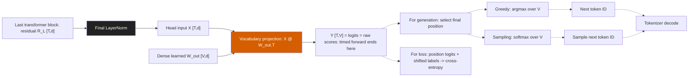
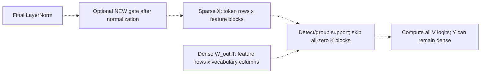

# Vocabulary head: scores, sparsity, and what could become cheaper

**Question:** Where are vocabulary scores computed, and which sparsity could reduce that work?

**Method and coverage:** A conceptual reading of the existing 14M/31M/70M forward implementations. Shapes use the existing batch-1, 2,048-position, BF16, 50,304-way full-logits workload. This document adds no experiment, gate, kernel, sparsity measurement, or timing result. The toy matrices below illustrate algebra; they are not activations from a checkpoint.

[Figure 09 - output path and hypothetical sparse input](../figures/09-output-head-dataflow.pdf)

## The correct output path

Let `R_L` be the final transformer block's residual output and `X = LayerNorm(R_L)` be the actual head input. If you use `H_L` for the already normalized final hidden state, then `H_L = X`. This `X` is different from the existing lowercase `h` site inside the MLP before its down projection.

**There is no `Y -> scores` dot product. `Y` already contains the scores.** For vocabulary entry `v` at input position `t`, the bias-free head computes:

\[
Y_{t,v}=\sum_{j=1}^{d}X_{t,j}W_{\mathrm{out},v,j}.
\]

A matrix multiplication batches those dot products over positions and vocabulary entries. In stored PyTorch orientation `W_out` has shape `[V,d]`; in the user's `H_L @ W_out` notation the mathematical weight matrix would instead have shape `[d,V]`.

Softmax uses exponentials and a sum across the vocabulary, rather than another learned projection:

\[
p_{t,v}=\frac{\exp(Y_{t,v}-m_t)}{\sum_u\exp(Y_{t,u}-m_t)},\qquad m_t=\max_u Y_{t,u}.
\]

Greedy decoding needs only the largest logit, since softmax preserves their ordering. Sampling uses a probability distribution, potentially modified by a specified temperature or filtering rule. Our timed forward returns every position's logits; neither selection nor vocabulary softmax nor loss is in Figure 08's head category. The softmax within causal attention is a separate operation.

## Sparse head inputs: fewer terms per score, still all vocabulary entries

If the head input has exact-zero coordinates, their contributions can be omitted. Define `S_t = {j: X[t,j] != 0}`:

\[
Y_{t,v}=\sum_{j\in S_t}X_{t,j}W_{\mathrm{out},v,j}.
\]

For one position this is mathematically a smaller reduction: `[1, |S_t|] @ [|S_t|, V] -> [1,V]`. It can avoid multiplications and loading unused weight coordinates in a kernel that exploits the support. Across many positions, independently varying supports need grouping, indexing or a sparse kernel; they do not automatically become one compact dense matmul. A weight coordinate skipped for one position may still be loaded for another. Benefits depend on reuse, layout and preparation cost.

**Sparsifying `X` does not require sparsifying `Y`.** A few nonzero features can contribute to every vocabulary entry, producing dense logits. For example, for `X = [a, 0, b, 0]`:

\[
Y_v=aW_{v,1}+bW_{v,3}\quad\text{for every }v.
\]

We skip two terms in every score; we still score every candidate. In the mathematical softmax, even a zero logit has positive probability when all logits are finite. Setting logits to zero does not remove candidates. A vocabulary mask typically uses negative infinity to assign zero probability, which is a different restriction.

Thresholding `Y` after its dense projection cannot save the multiplication already performed. Filtering probabilities after a full softmax also comes after score computation. Computing only a candidate subset *before* projection could reduce the vocabulary dimension, but choosing that subset needs a selector or a proven bound. Excluded candidates can change the argmax, sampling distribution and full cross-entropy. This is a different design from activation-zero skipping with full outputs.

## Which structure might help?

There is no measured best head-sparsity structure in this analysis. For the existing full-sequence workload, **contiguous feature blocks that are zero across a small group of positions** are a plausible kernel-friendly candidate. This is an engineering hypothesis, not a recommendation to add a particular gate or use the existing 8x16 corner rule.

For `X[M,K] @ W_out.T[K,N]`, the dimensions are `M = positions`, `K = hidden features`, `N = vocabulary entries`. An all-zero activation tile spanning `B_M` positions and `B_K` features lets a suitable kernel skip that reduction block and the corresponding `B_K x B_N` weight slice for an output tile. It skips **feature contributions**, not vocabulary candidates. All `N` output entries remain required.

| Structure | Work it could remove | Main practical issue |
| --- | --- | --- |
| Independent zero activation elements | Individual dot-product terms | Per-position supports, indices and irregular reads; dense tensor-core execution may still be faster |
| Zero feature blocks shared within a token group | Entire reduction blocks and matching weight slices for that group | Supports become less sparse as the union across positions grows; detection and packing cost |
| Same inactive features across all positions | A globally smaller hidden dimension and compact dense GEMM | This shared structure is not established in our head inputs; inducing/pruning features changes the model |
| Structured zero weights | Weight products through a compatible sparse implementation | Separate weight-sparsity intervention; pattern and hardware support must match |
| Vocabulary subset chosen before the head | Fewer vocabulary scores and smaller output | Selector overhead, omitted candidates and changed full-output/probability contract |

Large token groups improve reuse but may erase sparsity: a feature is skippable for the entire group only if it is zero for every participating position. Small feature blocks offer more skipping opportunities but incur more metadata and scheduling overhead. Block sizes must be selected from measured head supports and kernel behavior, not copied from the h/z consumer. NVIDIA's [matrix multiplication guide](https://docs.nvidia.com/deeplearning/performance/dl-performance-matrix-multiplication/index.html) explains the reuse/parallelism tradeoff; [cuSPARSE documentation](https://docs.nvidia.com/cuda/cusparse/index.html#cusparsespmm) illustrates that sparse formats, layouts and algorithms have distinct performance constraints. Neither establishes the best implementation for these checkpoints.

The output-write floor remains: full BF16 logits occupy `2048 * 50304 * 2 = 206,045,184` bytes, or **196.5 MiB**, even if half of the hidden feature products are skipped. Therefore a 50% product reduction would not imply a 50% head-latency reduction. A fused consumer that avoids materializing all logits is another possible optimization, but its requested output and timing boundary would differ from the present full-logits contract.

## Where new activation sparsity would have to enter

The existing topology gates **h and z inside transformer blocks**. It does not gate the final residual state or normalized head input. Residual addition and learned projections do not guarantee that these intermediate zeros survive to `X`. Final LayerNorm can also destroy zeros:

\[
X_j=\gamma_j\frac{R_{L,j}-\mu}{\sqrt{\sigma^2+\epsilon}}+\beta_j.
\]

Even when `R_L[j] = 0`, this expression generally need not be zero. See [PyTorch LayerNorm](https://docs.pytorch.org/docs/2.11/generated/torch.nn.LayerNorm.html). A gate intended to create head-input zeros therefore belongs **after final LayerNorm and before the vocabulary projection**, including when those operations are fused in one kernel. Thresholding previously nonzero features would change logits and require a separate quality experiment. Exploiting existing exact zeros can preserve the mathematical result, but floating-point accumulation changes still require numerical qualification. Near-zero values are not exact-zero skip opportunities without changing the model's arithmetic.

The next diagnostic would be to measure exact-zero counts and all-zero feature-block coverage **at the actual normalized head input**, together with the existing dense head's compute/memory efficiency. This document does not perform those measurements or assert that useful sparsity exists there.

**Sources:** The existing forward's separate `final_norm` and `lm_head` calls in [Run064 stages.py](../../../runs/064-2026-10-07-pythia14m-forward-latency-decomposition/stages.py) and [Run065 stages.py](../../../runs/065-2026-10-07-larger-model-forward-decomposition/stages.py); the bias-free full-output implementation in [Run054 head.py](../../../runs/054-2026-09-24-pythia31m-t2-ph/latency/kernel/head/head.py); [Analysis042 workload and measurements](../README.md); primary documentation linked above. No manuscript claim is added.

**Aggregation and result:** Algebra and shape accounting only. No sampled activation statistics, timing aggregation, confidence interval or new measured speedup.

**Caption and legend:** Panel A shows the current final LayerNorm, head input, vocabulary projection and raw logits, followed by separate greedy/sampling alternatives. Black normalization and vermillion projection retain Figure 08's semantic colors. Solid outlines/arrows show the existing path; dashed ones mark downstream consumers or hypothetical interventions. Panel B shows a hypothetical post-normalization gate and feature-block skipping. The toy activation is 4x8, its transposed weight is 8x6, and output is 4x6. Gray hatched activation columns are zero; matching gray weight rows can be skipped for that token group. Green weight cells represent required slices, not a sparsified weight matrix, and green output cells denote required scores, not a nonzero-rate measurement.

**Caveats:** This is an explanatory diagram, not evidence of head sparsity or a speedup. Adding a gate, pruning weights, choosing a vocabulary subset, using last-position-only logits and changing the consumer are scientifically or operationally different choices. None was implemented or launched.

**Source script:** [04_output_head_diagram.py](../04_output_head_diagram.py). **Output:** [09-output-head-dataflow.pdf](../figures/09-output-head-dataflow.pdf).
